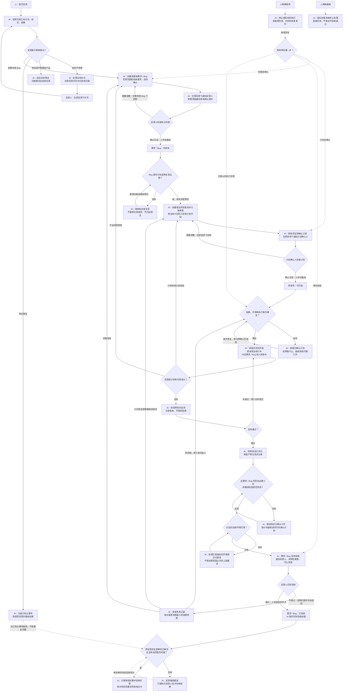

# 完整流程：人确认，AI 执行

受理反馈、拆分研发项、推进状态或配置流程字段时读取。以下是本版新流程的业务规则；写入使用当前项目的真实字段和等价状态。旧副本不因升级 Skill 自动换结构，已有有效确认按原依据保留。确认只适用于原先明确的事项、范围和计划；需求确认不能代替研发计划确认，也不能用旧确认补齐新计划缺失的字段或放行步骤。

## 三个必须由人操作的关口

| 对象 | AI 先准备什么 | 人亲自做什么 | AI 随后能做什么 |
|---|---|---|---|
| 需求／Bug | 写清要做什么、怎样验收，关联反馈，设“待确认”并通知相关反馈人 | 看过内容后，把“待确认”推进到“可研发” | 创建研发项并准备计划；Bug 还须有适用复现依据 |
| 研发项 | 把完整计划写入“研发计划”字段，设“待确认计划”并通知计划确认人 | 看过计划后，把“待确认计划”推进到“可开始” | 满足依赖及已有执行权限后调度、开发、自测 |
| 需求／Bug | 核对全部必要工作、自测及验收环境，设“待验收”，说明怎么检查并通知反馈人 | 实际验收，通过后完成“待验收”，或说明问题并退回研发阶段 | 保存验收结果，核对反馈是否全部解决，更新最终进展 |

流程字段中，人点击当前步骤的“完成节点”，才会进入下一步；单选字段中，人直接改为下一状态。这两种手动操作都可以，评论里的“同意”不能替代。AI 不代点确认节点，不凭无人反对、超时或有负责人放行。计划确认人采用用户或项目已明确指定的人，不由 AI 自行指定。

## Mermaid 完整流程图

图中“人”指该事项已明确的反馈人、计划确认人或验收人；其余推进由 AI 按真实结果完成。状态名称按项目映射写入，流程图本身不创建字段或授权实施。

暂停和撤销适用于任意未结束步骤，不是所有事项必经的节点。恢复时回到原来所处步骤，并核对原确认是否仍适用，不能越过尚缺的范围或计划确认。问题只影响单项时，不暂停整个运行器。撤销不能抹去已经发生的交付、失败和原始反馈。

## 状态由谁推进

| 对象 | 正常路径 | 责任 |
|---|---|---|
| 反馈 | 待受理 → 必要时待补充 → 已转办／跟进中 → 已结束／已答复 | AI 按实际处理结果更新；转办不能算解决，终态用项目实际选项 |
| 需求／Bug | 待确认 → 可研发 → 研发中 → 待验收 → 已验收 | 人完成第一步和验收；AI 在至少一个相关研发项实际开始、以及验收准备齐全时推进中间步骤 |
| 研发项 | 待确认计划 → 可开始 → 进行中 → 已交付 | AI 写计划并提交确认；人放行计划；AI 实际开始及完成自测后更新 |
| 验证记录 | 未执行、通过、部分通过、失败、受阻等 | AI 按每次实际测试或可核实的人工验收记录；结果不是顺序流程 |

需求／Bug 在至少一个相关研发项实际开始后，才进入“研发中”；只拆好研发项、还在等计划确认时保持“可研发”。具体研发项是否获准执行，以该项的人工计划确认及当前执行条件为准。一个子项已交付不使整个需求／Bug 进入待验收。验收不通过返回研发阶段并保留失败测试；原计划内返工沿用原确认，需要新计划则再次提交确认。

## 说什么，放在哪里

| 内容 | 位置与写法 |
|---|---|
| 反馈哪里不清楚、补截图或复现步骤 | 原反馈评论；一次问清具体缺口 |
| 拆成了哪几件事、请反馈人查看 | 原反馈评论；附需求／Bug 链接，直接说明如何确认 |
| 要做什么、什么结果算完成 | 需求／Bug 的范围与验收字段；围绕这些内容的讨论留在该项评论 |
| 研发计划 | 研发项的“研发计划”字段；计划修订、提醒和实施问题在该研发项评论 |
| 验收入口、检查方法、验收问题 | 对应需求／Bug 下；通知其真实关联反馈人，必要时从原反馈链接过去，不复制整段进度 |
| 运行器、去重、内部调查的过程 | 内部工作记录；只把会影响反馈人决定或使用的部分用简单话说明 |

评论不重复复制字段全文，不机械发送“已记录”。向本人通知也要核实实际渠道和送达方式；同账号 @ 自己不保证收到提醒，不能因为存在流程字段就声称通知已送达。沿用已有通知授权，不为提醒创建应用、bot、私信或新的调度。

## 流程字段与旧副本

流程字段承载有顺序的正常步骤；受阻、暂停和取消按项目现有异常字段或实际流程终止能力表达，不把它们排成每项都要走的步骤。终止不等于验收通过。“返回该节点”会使后续节点重置，执行前核对受影响确认、在途工作及历史；返回只重置当前进度，不删除旧证据。

“研发计划”字段可在计划确认节点显示并设为必填。确认角色使用人员字段的真实身份，不使用文字姓名；飞书管理者仍可能有完成全部节点的权限。人和 AI 共用账号时，字段权限不能区分两者，执行规则仍须禁止 AI 完成人工确认节点。

读到流程节点名称不证明支持完整流程操作。API 能读不等于能写，不能把普通单选更新当作完成节点；CLI 返回忽略字段也不算成功。实际读写能力以当前工具、本人网页和目标副本的验证为准；没有已验证的节点写入路径时保留该动作待处理，不改用绕过权限或必填检查的途径。

迁移仅在用户已明确授权目标副本后执行，使用正式发布的固定版本；Linux 绑定与运行状态按 [迁移入口](unattended.md#已授权的字段与绑定迁移) 操作，并按 [项目配置](project-mapping.md#校验与刷新) 保留旧绑定、结构和记录状态，暂停受影响的调度并等在途工作结束。逐项核对旧值对应的当前节点、正常结束或终止结果；直接类型转换可能把旧终态变成“正在进行的节点”，不能据此重开已完成事项或伪造新的确认。

新版流程和旧单选均可使用上述人工确认规则，前提是有真实等价状态、计划字段和可查回依据。新包的结构说明只适用于新模板或已明确迁移的副本，不覆盖旧项目固定契约。确实缺能力时列出哪一步受影响及仍可做什么，不为了升级自动加字段，也不拿评论替代人工状态确认。

切换前验证：现有状态与历史未丢失；人确认后扫描器能识别；未确认不派工；AI 可推进获准的步骤；退回、暂停及失败不误报通过；评论与状态变化不重复触发。核对绑定、读取、写入、通知和恢复结果后再继续受影响的调度。线上事实未完成验证时，不报告“迁移完成”。
