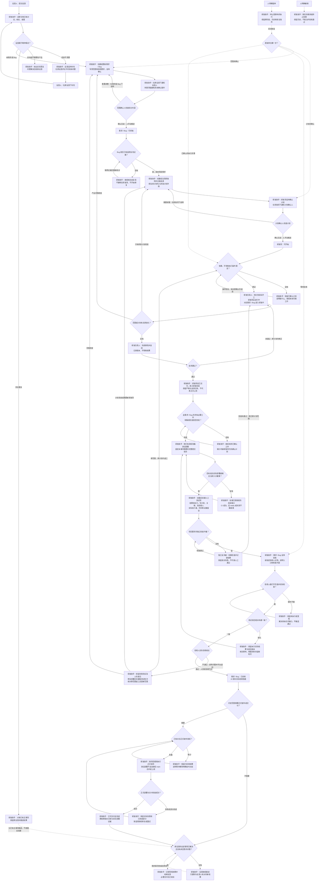

# 完整流程：人确认，AI 执行

受理反馈、拆分研发项、推进状态或配置流程字段时读取。以下是本版新流程的业务规则；写入使用当前项目的真实字段和等价状态。旧副本不因升级 Skill 自动换结构，已有有效确认按原依据保留。确认只适用于原先明确的事项、范围和计划；需求确认不能代替研发计划确认，也不能用旧确认补齐新计划缺失的字段或放行步骤。

## 谁在什么时候做什么

日常有七种分工，同一个人可以兼任几项。先看当前事项里写的是谁。把研发项交给另一位负责人，只改变谁来做；原计划仍由指定的计划确认人决定。

谁来做已有约定时，创建事项就按项目分工填好。表格里手动换过人，以最新人员字段为准。需要补空字段时先读回原项，区分开发、计划确认和验收三种分工。不要让同事反复挑人，也不要因为某人确认了计划，就把开发派给他。项目启用个人待办汇总后，常规提醒合并发送；有业务问题仍在相应事项下讨论。

| 角色 | 负责什么 | 在哪一步行动 |
|---|---|---|
| 反馈人 | 说清遇到什么、想要什么。资料不足时补一个例子、截图或操作步骤。 | 在 00 原反馈下补充。助手拆好后，从这里的链接打开对应需求或 Bug。 |
| 范围确认人 | 判断「拆出来的是不是我要的，做到什么样算对」。通常由相关反馈人担任，多人参与时按已有约定确定代表。 | 在 01 需求或 02 Bug 的「确认人」栏核实本人。拆对了，亲自把「待确认」推进到「可研发」；拆错了，在这一条下指出要改哪里。 |
| 计划确认人 | 看每个研发项打算怎么做、怎么测，决定这份计划能否开工。 | 在 03 看「研发计划」。同意后亲自把「待确认计划」推进到「可开始」；要改就在该研发项下说明。 |
| 研发助手（跟进流程） | 受理、查重、澄清，拆需求或 Bug，准备研发项和计划，提醒当前该行动的人。核对交付和测试，邀请验收，最后回原反馈交代结果。 | 反馈不清在 00 问，范围在 01/02 谈，计划在 03 谈。有人实际开工时更新「研发中」；所有必要项交付、测试准备好后更新「待验收」。 |
| 研发负责人 | 接手分给自己的研发项，按已确认的计划开发、自测，留下改了什么、测了哪版和结果。助手也可以是某一项的负责人。 | 负责 03 的「进行中 → 已交付」，自测结果记到 04。实际写表由项目约定的执行器办理。 |
| 独立复测者 | 项目要求复测时，由开发自测以外的执行者，在约定环境核实交付版本。可以是另一位同事，或独立执行的另一个 AI 会话。 | 在 04 留下本人实际测的版本、结果和问题；失败就交回研发负责人修正。 |
| 验收人 | 站在使用者的角度，按最初确认的条件实际试用，判断问题是否解决。通常由相关反馈人担任，以当前事项指定的人为准。 | 收到邀请后打开测试入口。通过就亲自在 01/02 完成「待验收」进入「已验收」；不通过就在同一条下写清现象，并按项目流程退回研发。 |

每条需求或 Bug 都分别指定范围确认人和验收人，每个研发项另看自己的计划确认人。原反馈人、范围确认人和验收人可以是同一位同事。多人共同反馈时，只采用项目已经指定的代表；验收人身份还不清楚时，先核实再邀请。

Linux 服务负责收飞书变化、断线重连、补查和唤醒 Codex。飞书里的独立助手是项目选定的操作账号。两者各有技术作用，业务决定仍由上表对应的人作出。项目负责人处理需要协调的负责人、优先级或授权问题；涉及正式上线时，由项目已有的发布授权人决定，再按项目原流程发布。

## 三个必须由人操作的关口

| 对象 | AI 先准备什么 | 人亲自做什么 | AI 随后能做什么 |
|---|---|---|---|
| 需求／Bug | 写清要做什么、怎样验收，关联反馈，设“待确认”并通知相关反馈人 | 看过内容后，把“待确认”推进到“可研发” | 创建研发项并准备计划；Bug 还须有适用复现依据 |
| 研发项 | 把完整计划写入“研发计划”字段，设“待确认计划”并通知计划确认人 | 看过计划后，把“待确认计划”推进到“可开始” | 满足依赖及已有执行权限后调度、开发、自测 |
| 需求／Bug | 核实目标测试部署，先建“未执行”的人工测试项；必要检查齐备后设“待验收”，说明入口与检查方法 | 实际验收，通过后完成“待验收”，或说明问题并退回研发阶段 | 保存真实验收结果；按项目授权推进必要正式发布，核对反馈是否全部解决 |

流程字段中，人点击当前步骤的“完成节点”，才会进入下一步；单选字段中，人直接改为下一状态。这两种手动操作都可以，评论里的“同意”不能替代。AI 不代点确认节点，不凭无人反对、超时或有负责人放行。计划确认人采用用户或项目已明确指定的人，不由 AI 自行指定。

## Mermaid 完整流程图

图中“研发助手”负责跟进，研发负责人负责开发与自测，独立复测者负责项目约定的复测。三个需要人决定的节点分别标出。测试部署采用项目已有环境和发布方式；无在线服务的项目用约定的固定制品验收。状态名称按项目映射写入，流程图本身不创建字段或授权实施。

暂停和撤销适用于任意未结束步骤，不是所有事项必经的节点。恢复时回到原来所处步骤，并核对原确认是否仍适用，不能越过尚缺的范围或计划确认。问题只影响单项时，不暂停整个运行器。撤销不能抹去已经发生的交付、失败和原始反馈。

## 状态由谁推进

| 对象 | 正常路径 | 责任 |
|---|---|---|
| 反馈 | 待受理 → 必要时待补充 → 已转办；咨询已答复，重复已归并，撤回已撤回 | 研发助手跟进已转办的关联事项，处理完在原反馈说明结果。按副本实际选项记录 |
| 需求／Bug | 待确认 → 可研发 → 研发中 → 待验收 → 已验收 | 人完成第一步和验收；AI 在至少一个相关研发项实际开始、以及验收准备齐全时推进中间步骤 |
| 研发项 | 待确认计划 → 可开始 → 进行中 → 已交付 | AI 写计划并提交确认；人放行计划；AI 实际开始及完成自测后更新；此处已交付只指研发产物 |
| 验证记录 | 未执行、通过、部分通过、失败、受阻等 | AI 在测试部署核实后先建未执行人工测试项；执行后按真实类型补结果；人的结论不能由 AI 检查替代 |
| 交付记录 | 待交付 → 进行中 → 已完成，失败／部分完成等保留事实 | AI 分别记录测试与正式环境的实际部署；需要先验收的正式发布由人验收通过且发布授权具备后执行 |

需求／Bug 在至少一个相关研发项实际开始后，才进入“研发中”；只拆好研发项、还在等计划确认时保持“可研发”。具体研发项是否获准执行，以该项的人工计划确认及当前执行条件为准。一个子项已交付不使整个需求／Bug 进入待验收。验收不通过返回研发阶段并保留失败测试；原计划内返工沿用原确认，需要新计划则再次提交确认。研发完成、测试部署就绪、人工验收通过与正式交付完成是不同事实；03 原“已交付”终态及历史来源保留，不批量改成“正式发布”。详细部署判据、测试字段复用和去重见 [测试环境与验收](test-environment.md)。

## 说什么，放在哪里

| 内容 | 位置与写法 |
|---|---|
| 反馈哪里不清楚、补截图或复现步骤 | 原反馈评论；一次问清具体缺口 |
| 拆成了哪几件事、请反馈人查看 | 原反馈评论；附需求／Bug 链接，直接说明如何确认 |
| 要做什么、什么结果算完成 | 需求／Bug 的范围与验收字段；围绕这些内容的讨论留在该项评论 |
| 研发计划 | 研发项的“研发计划”字段；计划修订、提醒和实施问题在该研发项评论 |
| 测试计划和每次执行结果 | 04 保存范围修订、类型、构建、标准和实际结果；部署后先建未执行计划，不提前填时间或证据 |
| 验收入口、检查方法、验收问题 | 对应需求／Bug 下，链接本轮 TEST；通知其真实关联反馈人，必要时从原反馈链接过去，不复制整段进度 |
| 正式发布进展和可用结果 | 对应交付／版本记录；按项目授权通知相关反馈人，区别测试可用与正式上线 |
| 运行器、去重、内部调查的过程 | 内部工作记录；只把会影响反馈人决定或使用的部分用简单话说明 |

评论不重复复制字段全文，不机械发送“已记录”。向本人通知也要核实实际渠道和送达方式；同账号 @ 自己不保证收到提醒，不能因为存在流程字段就声称通知已送达。沿用已有通知授权，不为提醒创建应用、bot、私信或新的调度。

## 流程字段与旧副本

流程字段承载有顺序的正常步骤；受阻、暂停和取消按项目现有异常字段或实际流程终止能力表达，不把它们排成每项都要走的步骤。终止不等于验收通过。“返回该节点”会使后续节点重置，执行前核对受影响确认、在途工作及历史；返回只重置当前进度，不删除旧证据。

“研发计划”字段可在计划确认节点显示并设为必填。确认角色使用人员字段的真实身份，不使用文字姓名；飞书管理者仍可能有完成全部节点的权限。人和 AI 共用账号时，字段权限不能区分两者，执行规则仍须禁止 AI 完成人工确认节点。

读到流程节点名称不证明支持完整流程操作。API 能读不等于能写，不能把普通单选更新当作完成节点；CLI 返回忽略字段也不算成功。实际读写能力以当前工具、本人网页和目标副本的验证为准；没有已验证的节点写入路径时保留该动作待处理，不改用绕过权限或必填检查的途径。

迁移仅在用户已明确授权目标副本后执行，使用正式发布的固定版本；Linux 绑定与运行状态按 [迁移入口](unattended.md#已授权的字段与绑定迁移) 操作，并按 [项目配置](project-mapping.md#校验与刷新) 保留旧绑定、结构和记录状态，暂停受影响的调度并等在途工作结束。逐项核对旧值对应的当前节点、正常结束或终止结果；直接类型转换可能把旧终态变成“正在进行的节点”，不能据此重开已完成事项或伪造新的确认。

新版流程和旧单选均可使用上述人工确认规则，前提是有真实等价状态、计划字段和可查回依据。新包的结构说明只适用于新模板或已明确迁移的副本，不覆盖旧项目固定契约。确实缺能力时列出哪一步受影响及仍可做什么，不为了升级自动加字段，也不拿评论替代人工状态确认。

切换前验证：现有状态与历史未丢失；人确认后扫描器能识别；未确认不派工；AI 可推进获准的步骤；退回、暂停及失败不误报通过；评论与状态变化不重复触发。核对绑定、读取、写入、通知和恢复结果后再继续受影响的调度。线上事实未完成验证时，不报告“迁移完成”。

本版可在既有 2.0.0 字段中表达测试部署与人工验收：复用 04 的“未执行”、标准快照、构建和真实关联，05 的环境及部署记录，07 的正式版本。只更新 Skill 规则不改旧绑定、字段或状态；先核实目标副本能力，再按明确切换点处理后续未完成工作。旧自测和已结束事项保留当时真实类型与证据，不能批量改成人工验收或重新打开。
